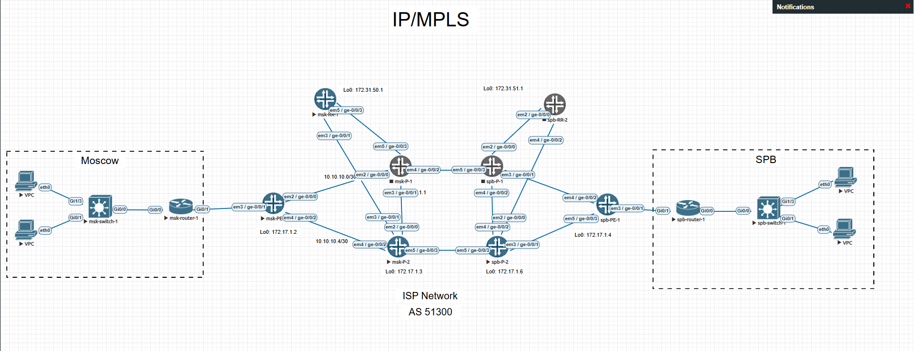
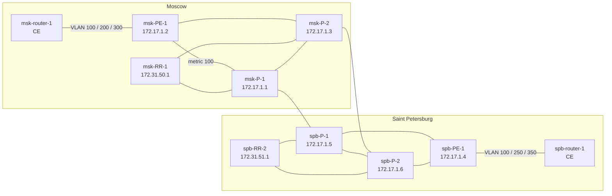
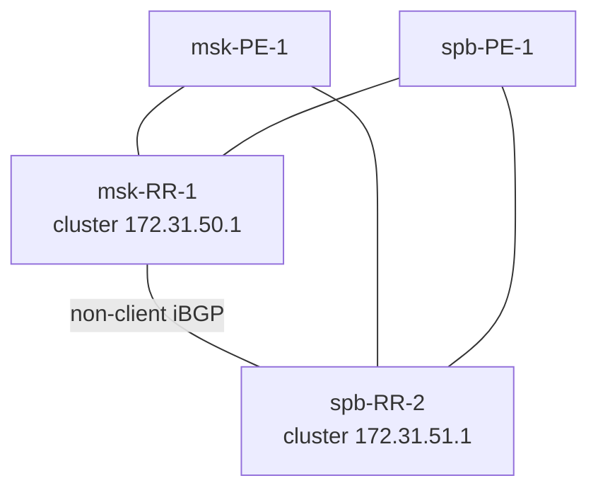
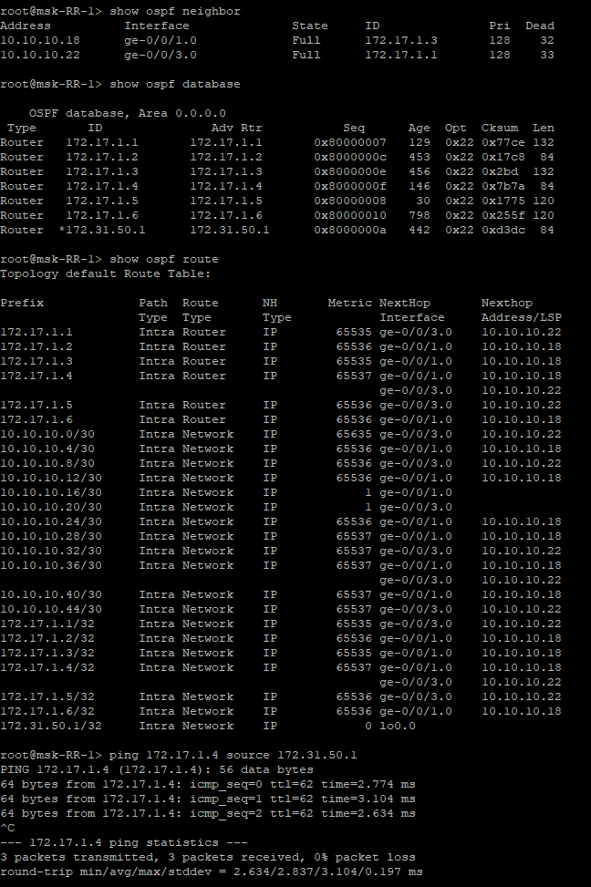
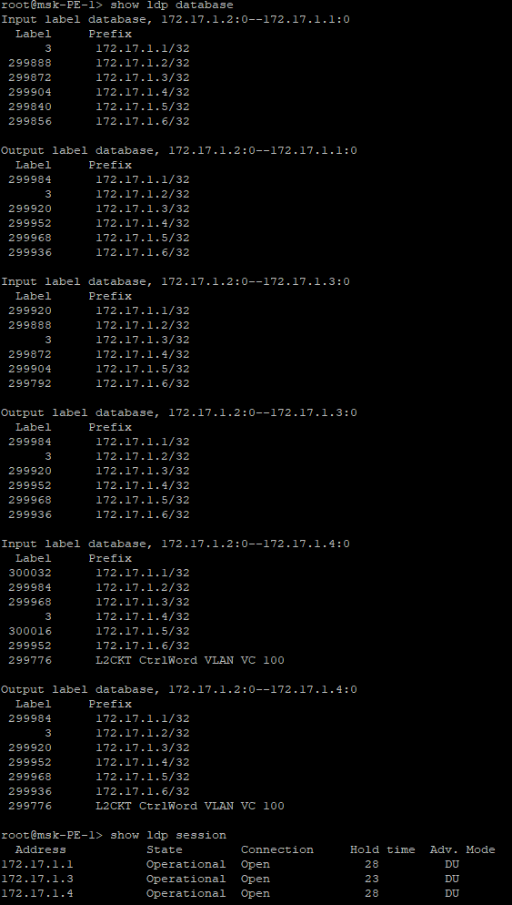
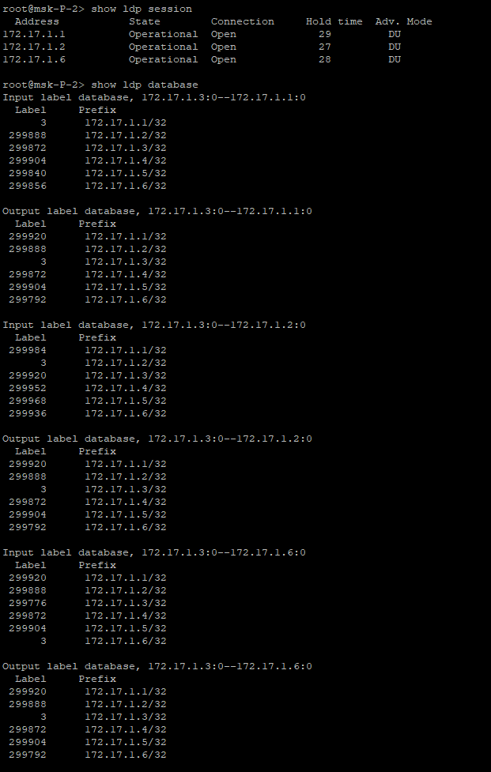
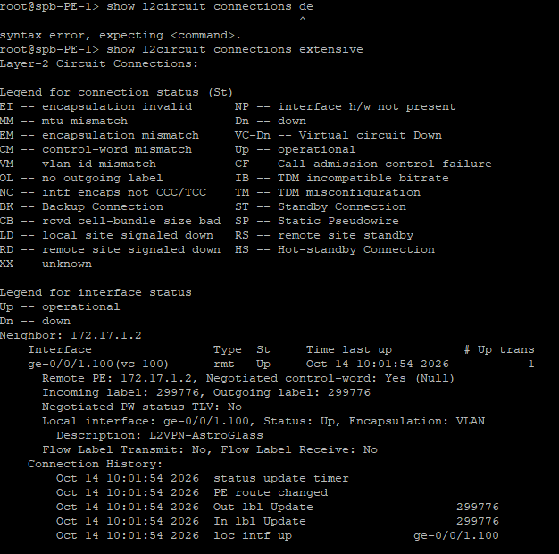
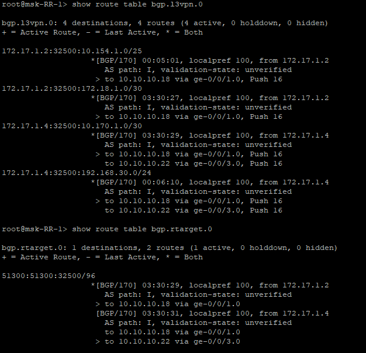
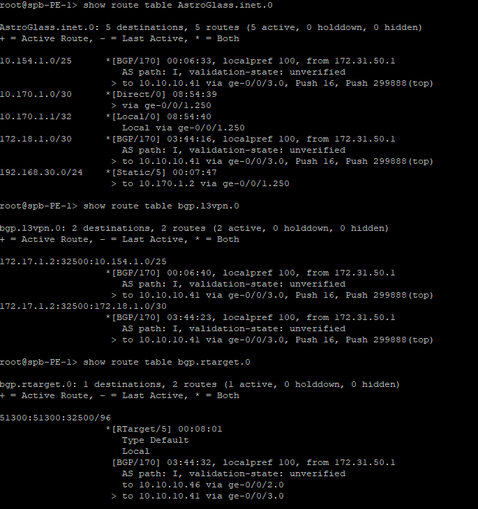

# IP/MPLS Service Provider Lab
 
> **Platform:** EVE-NG | **SP routers:** Juniper vMX, Junos 14.1R1 | **CE:** Cisco IOS, VIOS-ADVENTERPRISEK9-M Version 15.5(3)M | **AS:** 51300  
> **Focus:** BGP-free MPLS core, route reflectors, L3VPN, L2VPN pseudowire, Internet access, Routing Engine protection
 
 
A two-site service provider network (Moscow and Saint Petersburg) built on Juniper vMX in EVE-NG. Over one MPLS core the operator delivers three services to the customer **AstroGlass**: a Layer 3 VPN, a Layer 2 pseudowire and Internet access over eBGP.
 
This README covers the design, the configuration of every layer, how each layer is verified, and the real problems found while building the lab.
 
Device configurations are in [`configs/`](configs/), exported with `show configuration | display set` and with password hashes removed: [msk-PE-1](configs/msk-PE-1/msk-PE-1.txt), [spb-PE-1](configs/spb-PE-1/spb-PE-1.txt), [msk-RR-1](configs/msk-RR-1/msk-RR-1.txt), [msk-P-1](configs/msk-P-1/msk-P-1.txt), [msk-P-2](configs/msk-P-2/msk-P-2.txt), [spb-P-1](configs/spb-P-1/spb-P-1.txt), [spb-P-2](configs/spb-P-2/spb-P-2.txt), [spb-RR-2](configs/spb-RR-2/spb-RR-2.txt), [msk-router-1](configs/msk-router-1/msk-router-1.txt), [spb-router-1](configs/spb-router-1/spb-router-1.txt), [msk-switch-1](configs/msk-switch-1/msk-switch-1.txt), [spb-switch-1](configs/spb-switch-1/spb-switch-1.txt).
 
---
 
## Contents
 
- [Services](#services)
- [What the lab demonstrates](#what-the-lab-demonstrates)
- [Topology](#topology)
- [Addressing](#addressing)
- [Design decisions](#design-decisions)
- [Implementation and verification](#implementation-and-verification)
  - [IGP: OSPF](#igp-ospf)
  - [MPLS: LDP](#mpls-ldp)
  - [BGP: route reflectors](#bgp-route-reflectors)
  - [L3VPN](#l3vpn)
  - [L2VPN: LDP-signalled pseudowire](#l2vpn-ldp-signalled-pseudowire)
  - [Internet access: customer eBGP](#internet-access-customer-ebgp)
  - [Customer sites](#customer-sites)
  - [Routing Engine protection](#routing-engine-protection)
- [Troubleshooting case studies](#troubleshooting-case-studies)
- [Platform notes: vMX 14.1 on EVE-NG](#platform-notes-vmx-141-on-eve-ng)
- [Roadmap](#roadmap)
- [References](#references)
---
 
## Services
 
| Service | Implementation | Moscow (msk-PE-1) | Saint Petersburg (spb-PE-1) |
|---|---|---|---|
| L3VPN | VRF `AstroGlass`, MP-BGP `inet-vpn` | ge-0/0/1.200, VLAN 200 | ge-0/0/1.250, VLAN 250 |
| L2VPN | `l2circuit`, VC ID 100 | ge-0/0/1.100, VLAN 100 | ge-0/0/1.100, VLAN 100 |
| Internet | eBGP with the customer | ge-0/0/1.300, VLAN 300, AS 4165 | ge-0/0/1.350, VLAN 350, AS 32500 |
 
All three services reach the customer over a single 802.1Q trunk per site, one VLAN per service. Each one carries real customer traffic: the Marketing LANs talk over the L2VPN, the Accounts and Managers LANs over the L3VPN, and the Saint Petersburg site announces its public prefix through the Internet service. See [Customer sites](#customer-sites).
 
---
 
## What the lab demonstrates
 
| Area | Implemented |
|---|---|
| IGP | OSPFv2 area 0, point-to-point core links, IGP metric to select the primary path |
| MPLS | LDP on all core links, targeted LDP for the pseudowire, LSP verification with MPLS OAM |
| BGP | iBGP through two route reflectors with separate cluster IDs, MP-BGP `inet-vpn`, Route Target Constraint, BFD |
| VPN services | L3VPN (VRF, RD/RT, `vrf-table-label`), L2VPN (LDP-signalled pseudowire, Ethernet VLAN mode) |
| Internet | Customer eBGP sessions with an inbound prefix filter, a prefix limit and a community-based outbound policy |
| Customer edge | Cisco IOSv CEs with router-on-a-stick LANs, one trunk per site for all three services, end-to-end tests between VPCs |
| Security | Routing Engine protection filter with policers, counters and logging |
| Operations | Layer-by-layer verification, packet-level troubleshooting, isolating a platform limitation |
 
---
 
## Topology
 

 
Physical topology: core links and PE–CE trunks.
 

 
BGP control plane. P routers do not run BGP.
 

 
---
 
## Addressing
 
### Loopbacks
 
| Device | Role | lo0 |
|---|---|---|
| msk-RR-1 | Route reflector | 172.31.50.1/32 |
| spb-RR-2 | Route reflector | 172.31.51.1/32 |
| msk-P-1 | P router | 172.17.1.1/32 |
| msk-P-2 | P router | 172.17.1.3/32 |
| spb-P-1 | P router | 172.17.1.5/32 |
| spb-P-2 | P router | 172.17.1.6/32 |
| msk-PE-1 | PE, Moscow | 172.17.1.2/32 |
| spb-PE-1 | PE, Saint Petersburg | 172.17.1.4/32 |
 
### Core links
 
Core links use /30 subnets from 10.10.10.0/24. EVE-NG interfaces `em2`–`em5` correspond to Junos `ge-0/0/0`–`ge-0/0/3`.
 
| Subnet | Side A | Side B |
|---|---|---|
| 10.10.10.0/30 | msk-PE-1 ge-0/0/0 (.2) | msk-P-1 ge-0/0/0 (.1) |
| 10.10.10.4/30 | msk-PE-1 ge-0/0/2 (.5) | msk-P-2 ge-0/0/2 (.6) |
| 10.10.10.8/30 | msk-P-1 ge-0/0/2 (.10) | spb-P-1 ge-0/0/3 (.9) |
| 10.10.10.12/30 | msk-P-2 ge-0/0/3 (.14) | spb-P-2 ge-0/0/3 (.13) |
| 10.10.10.16/30 | msk-RR-1 ge-0/0/1 (.17) | msk-P-2 ge-0/0/1 (.18) |
| 10.10.10.20/30 | msk-RR-1 ge-0/0/3 (.21) | msk-P-1 ge-0/0/3 (.22) |
| 10.10.10.24/30 | msk-P-1 ge-0/0/1 (.26) | msk-P-2 ge-0/0/0 (.25) |
| 10.10.10.28/30 | spb-RR-2 ge-0/0/2 (.29) | spb-P-2 ge-0/0/0 (.30) |
| 10.10.10.32/30 | spb-RR-2 ge-0/0/0 (.33) | spb-P-1 ge-0/0/0 (.34) |
| 10.10.10.36/30 | spb-P-1 ge-0/0/2 (.37) | spb-P-2 ge-0/0/2 (.38) |
| 10.10.10.40/30 | spb-PE-1 ge-0/0/3 (.42) | spb-P-2 ge-0/0/1 (.41) |
| 10.10.10.44/30 | spb-PE-1 ge-0/0/2 (.45) | spb-P-1 ge-0/0/1 (.46) |
 
### Service handoff (PE–CE)
 
| Site | Service | PE interface | VLAN | PE address | CE address | Customer AS |
|---|---|---|---|---|---|---|
| Moscow | L2VPN | msk-PE-1 ge-0/0/1.100 | 100 | — | 10.120.0.2 | — |
| Moscow | L3VPN | msk-PE-1 ge-0/0/1.200 | 200 | 172.18.1.1/30 | 172.18.1.2 | — |
| Moscow | Internet | msk-PE-1 ge-0/0/1.300 | 300 | 72.64.35.121/30 | 72.64.35.122 | 4165 |
| Saint Petersburg | L2VPN | spb-PE-1 ge-0/0/1.100 | 100 | — | 10.120.0.1 | — |
| Saint Petersburg | L3VPN | spb-PE-1 ge-0/0/1.250 | 250 | 10.170.1.1/30 | 10.170.1.2 | — |
| Saint Petersburg | Internet | spb-PE-1 ge-0/0/1.350 | 350 | 31.120.12.1/30 | 31.120.12.2 | 32500 |
 
---
 
## Design decisions
 
| Decision | Why |
|---|---|
| **BGP-free core** | P routers run only OSPF and LDP. Customer and VPN routes live on PEs and RRs; the core only switches labels and never needs a BGP table. |
| **Out-of-path route reflectors** | RRs are not in the MPLS forwarding path and do not run LDP; OSPF overload on msk-RR-1 keeps transit traffic away from it. Their `inet.3` is empty, so next hops of `bgp.l3vpn.0` and `bgp.rtarget.0` routes are resolved through `inet.0` with `routing-options resolution rib`. |
| **Two RRs, separate clusters** | Each RR uses its own loopback as cluster ID. Every PE peers with both RRs, and the RRs peer with each other as non-clients, so losing one RR does not stop route distribution. |
| **Dual-homed PEs and RRs** | Every PE and RR connects to both P routers of its site, so a single P router or link failure only changes the IGP path. |
| **RD per PE, RT per VPN** | RD = `<PE loopback>:32500`, so routes from different PEs stay distinct on the RRs. A single RT, `target:51300:32500`, defines VPN membership. |
| **Route Target Constraint** | With `family route-target`, PEs signal which RTs they import, and VPN routes are sent only where they are needed. |
| **`vrf-table-label`** | One label per VRF; the egress PE pops it and does an IP lookup in the VRF table. |
| **LDP instead of RSVP-TE** | The lab focuses on service delivery. In production RSVP-TE or Segment Routing would add traffic engineering and fast reroute. |
| **IGP metric for path preference** | `metric 100` on msk-PE-1 towards msk-P-1 makes msk-P-2 the preferred exit from msk-PE-1; the link to msk-P-1 stays as the backup. |
| **BFD on PE–RR sessions** | 300 ms × 3 detects a failure in under a second instead of waiting for the 90-second BGP hold timer. |
| **One trunk, one VLAN per service** | `flexible-ethernet-services` lets one PE–CE port carry a CCC unit (L2VPN) and IP units (L3VPN, Internet) side by side. |
| **Customer link subnets in iBGP** | The PE export policy advertises its customer-facing /30s to the RRs while filtering out core links and loopbacks, so remote PEs can resolve the next hops of customer eBGP routes. |
| **Communities decide what customers receive** | Customer prefixes are tagged 51300:100 on import and PE–CE link subnets 51300:200 on export to the RRs. The outbound policy towards every customer accepts only these two communities, so a new customer site needs changes only on its own PE. |
 
---
 
## Implementation and verification
 
Snippets are taken from msk-PE-1 unless noted otherwise.
 
### IGP: OSPF
 
All SP routers run OSPF area 0. Core links are point-to-point, and loopbacks are advertised so that LDP and BGP can use them. Customer prefixes never enter the IGP.
 
```
set protocols ospf area 0.0.0.0 interface lo0.0
set protocols ospf area 0.0.0.0 interface ge-0/0/0.0 interface-type p2p
set protocols ospf area 0.0.0.0 interface ge-0/0/0.0 metric 100
set protocols ospf area 0.0.0.0 interface ge-0/0/2.0 interface-type p2p
```
 
msk-RR-1 also runs `set protocols ospf overload`. The RR stays reachable, but OSPF uses it as a transit node only as a last resort, so no LSP is routed through a router that does not run MPLS.
 
Verification:
 
```
show ospf neighbor                    # every core neighbor in Full
show ospf route                       # loopbacks of all SP routers
ping 172.17.1.4 source 172.31.50.1    # msk-RR-1 -> spb-PE-1, loopback to loopback
```
 
Output on msk-RR-1, with all eight SP routers in the OSPF database. Because of OSPF overload, msk-RR-1's own transit links cost 65535, so every route through the core has a metric of 65535 or more; only the directly connected subnets keep metric 1.
 


### MPLS: LDP
 
MPLS and LDP run on every core link. `ldp interface lo0.0` enables targeted LDP between PE loopbacks, which signals the pseudowire.
 
```
set interfaces ge-0/0/2 mtu 2000
set interfaces ge-0/0/2 unit 0 family inet address 10.10.10.5/30
set interfaces ge-0/0/2 unit 0 family mpls
set protocols mpls interface ge-0/0/0.0
set protocols mpls interface ge-0/0/2.0
set protocols ldp interface ge-0/0/0.0
set protocols ldp interface ge-0/0/2.0
set protocols ldp interface lo0.0
```
 
Verification:
 
```
show ldp neighbor
show ldp session
show route table inet.3
ping mpls ldp 172.17.1.4
traceroute mpls ldp 172.17.1.4
```
 
LDP LSPs on msk-PE-1 (`show route table inet.3`):
 
```
172.17.1.3/32      *[LDP/9] 00:02:34, metric 1
                    > to 10.10.10.6 via ge-0/0/2.0
172.17.1.4/32      *[LDP/9] 00:02:34, metric 1
                    > to 10.10.10.6 via ge-0/0/2.0, Push 299872
172.17.1.6/32      *[LDP/9] 00:02:34, metric 1
                    > to 10.10.10.6 via ge-0/0/2.0, Push 299792
```
 
msk-P-2 (172.17.1.3) is the directly connected next hop, so its LSP pushes no label: penultimate hop popping. LSPs towards spb-PE-1 and spb-P-2 push the labels learned from msk-P-2. msk-P-2 is the preferred exit by design: the link to msk-P-1 carries OSPF metric 100.
 
Label databases on msk-PE-1 for its sessions with msk-P-1, msk-P-2 and, over targeted LDP, spb-PE-1. The targeted session also carries the pseudowire label (`L2CKT CtrlWord VLAN VC 100`):
 

On msk-P-2, with sessions to msk-P-1, msk-PE-1 and spb-P-2. For its own loopback it advertises label 3, implicit null, which requests penultimate hop popping:
 

### BGP: route reflectors
 
PE, iBGP to both route reflectors:
 
```
set routing-options autonomous-system 51300
set routing-options resolution rib bgp.rtarget.0 resolution-ribs inet.0
set protocols bgp group BGP-RR type internal
set protocols bgp group BGP-RR local-address 172.17.1.2
set protocols bgp group BGP-RR family inet unicast
set protocols bgp group BGP-RR family inet-vpn unicast
set protocols bgp group BGP-RR family route-target
set protocols bgp group BGP-RR export BGP
set protocols bgp group BGP-RR neighbor 172.31.50.1 bfd-liveness-detection minimum-interval 300
set protocols bgp group BGP-RR neighbor 172.31.50.1 bfd-liveness-detection multiplier 3
set protocols bgp group BGP-RR neighbor 172.31.51.1 bfd-liveness-detection minimum-interval 300
set protocols bgp group BGP-RR neighbor 172.31.51.1 bfd-liveness-detection multiplier 3
```
 
Route reflector msk-RR-1. The `BGP-CLIENTS` group has a cluster ID, so its members are clients; the `BGP-RR` group towards spb-RR-2 has none, so that peering is non-client:
 
```
set routing-options autonomous-system 51300
set routing-options resolution rib bgp.l3vpn.0 resolution-ribs inet.0
set routing-options resolution rib bgp.rtarget.0 resolution-ribs inet.0
set protocols bgp group BGP-CLIENTS type internal
set protocols bgp group BGP-CLIENTS local-address 172.31.50.1
set protocols bgp group BGP-CLIENTS cluster 172.31.50.1
set protocols bgp group BGP-CLIENTS family inet unicast
set protocols bgp group BGP-CLIENTS family inet-vpn unicast
set protocols bgp group BGP-CLIENTS family route-target
set protocols bgp group BGP-CLIENTS neighbor 172.17.1.2 description msk-PE-1
set protocols bgp group BGP-CLIENTS neighbor 172.17.1.4 description spb-PE-1
set protocols bgp group BGP-RR type internal
set protocols bgp group BGP-RR local-address 172.31.50.1
set protocols bgp group BGP-RR family inet unicast
set protocols bgp group BGP-RR family inet-vpn unicast
set protocols bgp group BGP-RR family route-target
set protocols bgp group BGP-RR neighbor 172.31.51.1 description spb-RR-2
```
 
Verification:
 
```
show bgp summary                  # on the RR: both PEs Established
show bfd session                  # on the PEs: sessions to the RRs Up
show route table bgp.rtarget.0    # RT membership from both PEs
show route table bgp.l3vpn.0      # on the RR: VPN routes from both PEs
```
 
`show bgp summary` on msk-RR-1:
 
```
Groups: 2 Peers: 3 Down peers: 1
Table          Tot Paths  Act Paths Suppressed    History Damp State    Pending
inet.0
                       3          3          0          0          0          0
bgp.l3vpn.0
                       2          2          0          0          0          0
bgp.rtarget.0
                       2          1          0          0          0          0
Peer                     AS      InPkt     OutPkt    OutQ   Flaps Last Up/Dwn State|#Active/Received/Accepted/Damped...
172.17.1.2            51300         24         23       0       2        7:35 Establ
  inet.0: 1/1/1/0
  bgp.l3vpn.0: 1/1/1/0
  bgp.rtarget.0: 1/1/1/0
172.17.1.4            51300         34         29       0       3       10:44 Establ
  inet.0: 2/2/2/0
  bgp.l3vpn.0: 1/1/1/0
  bgp.rtarget.0: 0/1/1/0
172.31.51.1           51300          0          0       0       0     2:19:53 Active
```
 
- Each PE sends one VPN route, its PE–CE subnet in `AstroGlass`, and its Internet link subnet; spb-PE-1 also sends the customer prefix 95.235.16.0/24.
- Both PEs advertise the same RT membership route, 51300:51300:32500, so the RR keeps one of them active and shows the other as received only (`0/1/1/0`).
- spb-RR-2 was shut down when this was captured, hence `Active`.
BFD from msk-PE-1 to the RR runs at the configured 300 ms interval and detects a failure after 0.9 s. The interface column is empty because this is a multihop session between loopbacks:
 
```
msk-PE-1> show bfd session
                                                  Detect   Transmit
Address                  State     Interface      Time     Interval  Multiplier
172.31.50.1              Up                       0.900     0.300        3
```
 
### L3VPN
 
```
set interfaces ge-0/0/1 vlan-tagging
set interfaces ge-0/0/1 encapsulation flexible-ethernet-services
set interfaces ge-0/0/1 unit 200 description L3VPN
set interfaces ge-0/0/1 unit 200 vlan-id 200
set interfaces ge-0/0/1 unit 200 family inet address 172.18.1.1/30
set routing-instances AstroGlass instance-type vrf
set routing-instances AstroGlass interface ge-0/0/1.200
set routing-instances AstroGlass route-distinguisher 172.17.1.2:32500
set routing-instances AstroGlass vrf-target target:51300:32500
set routing-instances AstroGlass vrf-table-label
```
 
`vrf-target` generates the import and export policies: exported routes get the RT attached, and received routes carrying the same RT are imported. On spb-PE-1 the VRF uses ge-0/0/1.250 (10.170.1.1/30) and RD 172.17.1.4:32500.
 
Verification:
 
```
show route table AstroGlass.inet.0
show route advertising-protocol bgp 172.31.50.1 table AstroGlass.inet.0
show route label 16
ping 10.170.1.1 routing-instance AstroGlass source 172.18.1.1
```
 
The VPN route arrives from the RR with spb-PE-1's route distinguisher (`show route table bgp.l3vpn.0` on msk-PE-1):
 
```
172.17.1.4:32500:10.170.1.0/30
                   *[BGP/170] 00:00:20, localpref 100, from 172.31.50.1
                      AS path: I, validation-state: unverified
                    > to 10.10.10.6 via ge-0/0/2.0, Push 16, Push 299872(top)
```
 
Its RT matches the VRF, so msk-PE-1 imports it (`show route table AstroGlass.inet.0`):
 
```
10.170.1.0/30      *[BGP/170] 00:00:20, localpref 100, from 172.31.50.1
                      AS path: I, validation-state: unverified
                    > to 10.10.10.6 via ge-0/0/2.0, Push 16, Push 299872(top)
172.18.1.0/30      *[Direct/0] 02:11:27
                    > via ge-0/0/1.200
172.18.1.1/32      *[Local/0] 02:11:28
                      Local via ge-0/0/1.200
```
 
Traffic to the Saint Petersburg site carries two labels: 299872, the LDP label towards spb-PE-1, on top, and 16, the VPN label, inside. With `vrf-table-label` the VPN label is one label for the whole VRF; spb-PE-1 pops it and does an IP lookup in its `AstroGlass.inet.0`. msk-PE-1 allocated the same value, 16, for its own VRF:
 
```
16                 *[VPN/0] 02:12:34
                      to table AstroGlass.inet.0, Pop
```
 
In the opposite direction spb-PE-1 receives 172.17.1.2:32500:172.18.1.0/30 from the RR and imports it into its own `AstroGlass` VRF the same way. The customer LANs carried by the VRF are covered in [Customer sites](#customer-sites).
 
### L2VPN: LDP-signalled pseudowire
 
```
set interfaces ge-0/0/1 unit 100 description L2VPN
set interfaces ge-0/0/1 unit 100 encapsulation vlan-ccc
set interfaces ge-0/0/1 unit 100 vlan-id 100
set interfaces ge-0/0/1 unit 100 family ccc
set protocols l2circuit neighbor 172.17.1.4 interface ge-0/0/1.100 virtual-circuit-id 100
set protocols l2circuit neighbor 172.17.1.4 interface ge-0/0/1.100 mtu 1600
```
 
The pseudowire is signalled over a targeted LDP session between the PE loopbacks (RFC 8077). Both ends must use the same VC ID and MTU, and the core MTU must leave room for the customer frame, the control word and two labels.
 
Verification:
 
```
show l2circuit connections                    # connection Up
show ldp neighbor                             # includes the targeted neighbor 172.17.1.4 via lo0.0
ping mpls l2circuit interface ge-0/0/1.100
```
 
Pseudowire state on msk-PE-1:
 
```
l2circuit.0
172.17.1.4:CtrlWord:4:100:Local/96
                   *[L2CKT/7] 00:14:37, metric2 1
                    > to 10.10.10.6 via ge-0/0/2.0, Push 299872
 
mpls.0
299776             *[L2CKT/7] 00:02:28
                    > via ge-0/0/1.100, Pop       Offset: 4
ge-0/0/1.100       *[L2CKT/7] 00:02:28, metric2 1
                    > to 10.10.10.6 via ge-0/0/2.0, Push 299776, Push 299872(top) Offset: 252
```
 
- `CtrlWord:4:100`: the control word is used, encapsulation type 4 is Ethernet VLAN mode, VC ID 100.
- Frames received on ge-0/0/1.100 get two labels: the pseudowire label 299776 advertised by spb-PE-1, and the LDP label 299872 towards spb-PE-1 on top.
- Pseudowire label 299776 arriving from the core is popped and the frame leaves via ge-0/0/1.100. Both PEs happened to allocate the same value, 299776, for their side of the pseudowire.
The same pseudowire seen from spb-PE-1 (`show l2circuit connections extensive`): Up, control word negotiated, label 299776 in both directions:
 

### Internet access: customer eBGP
 
Two communities decide what the Internet customers receive:
 
| Community | Value | Attached to | Where |
|---|---|---|---|
| `CLIENTS` | 51300:100 | customer prefixes | import policy on the PE that faces the customer |
| `CLIENTS-P2P` | 51300:200 | PE–CE link subnets | term `P2P` of the export policy towards the RRs |
 
Both PEs apply the same outbound policy to their customers: only routes with one of the two communities are sent, and any other route that ends up in BGP stays inside the network. Two `from community` lines in one term match a route that carries either of them:
 
```
set policy-options community CLIENTS members 51300:100
set policy-options community CLIENTS-P2P members 51300:200
set policy-options policy-statement CLIENTS-OUT term CLIENTS from community CLIENTS
set policy-options policy-statement CLIENTS-OUT term CLIENTS from community CLIENTS-P2P
set policy-options policy-statement CLIENTS-OUT term CLIENTS then accept
set policy-options policy-statement CLIENTS-OUT term REJECT then reject
```
 
msk-PE-1, Moscow customer (AS 4165). The session is limited to 10 prefixes: at 80 % of the limit the router logs a warning, and above the limit it tears the session down and keeps it idle for 10 minutes.
 
```
set interfaces ge-0/0/1 unit 300 description Internet
set interfaces ge-0/0/1 unit 300 vlan-id 300
set interfaces ge-0/0/1 unit 300 family inet address 72.64.35.121/30
set protocols bgp group CLIENTS type external
set protocols bgp group CLIENTS family inet unicast prefix-limit maximum 10
set protocols bgp group CLIENTS family inet unicast prefix-limit teardown 80
set protocols bgp group CLIENTS family inet unicast prefix-limit teardown idle-timeout 10
set protocols bgp group CLIENTS export CLIENTS-OUT
set protocols bgp group CLIENTS neighbor 72.64.35.122 peer-as 4165
```
 
spb-PE-1, Saint Petersburg customer (AS 32500). The import policy accepts only the prefix assigned to the customer and tags it with `CLIENTS`:
 
```
set policy-options prefix-list AstroGlass-Internet 95.235.16.0/24
set policy-options policy-statement IMPORT-ASTOGLASS-INTERNET term 1 from prefix-list AstroGlass-Internet
set policy-options policy-statement IMPORT-ASTOGLASS-INTERNET term 1 then community add CLIENTS
set policy-options policy-statement IMPORT-ASTOGLASS-INTERNET term 1 then accept
set policy-options policy-statement IMPORT-ASTOGLASS-INTERNET then reject
set protocols bgp group CLIENTS export CLIENTS-OUT
set protocols bgp group CLIENTS neighbor 31.120.12.2 passive
set protocols bgp group CLIENTS neighbor 31.120.12.2 import IMPORT-ASTOGLASS-INTERNET
set protocols bgp group CLIENTS neighbor 31.120.12.2 peer-as 32500
```
 
The export policy `BGP` on the `BGP-RR` group keeps core links and loopbacks out of BGP and advertises the other connected subnets to the RRs. Term `P2P` matches the Internet handoff by interface and tags it with `CLIENTS-P2P`; on spb-PE-1 it matches ge-0/0/1.350. The term has to stay above term `BGP`, which would otherwise accept the route first, without the community.
 
```
set policy-options prefix-list DENY 10.10.10.0/24
set policy-options prefix-list DENY 172.17.1.0/24
set policy-options policy-statement BGP term DENY from protocol direct
set policy-options policy-statement BGP term DENY from prefix-list-filter DENY orlonger
set policy-options policy-statement BGP term DENY then reject
set policy-options policy-statement BGP term P2P from protocol direct
set policy-options policy-statement BGP term P2P from interface ge-0/0/1.300
set policy-options policy-statement BGP term P2P then community add CLIENTS-P2P
set policy-options policy-statement BGP term P2P then accept
set policy-options policy-statement BGP term BGP from protocol direct
set policy-options policy-statement BGP term BGP then accept
```
 
A community is attached where a route enters BGP and checked where the route leaves towards a customer, so a new customer site needs changes only on its own PE.
 
Advertising the link subnets also lets remote PEs resolve the next hops of customer eBGP routes through an LSP. The Saint Petersburg customer prefix keeps the customer's address 31.120.12.2 as its BGP next hop, and msk-PE-1 resolves it through the advertised link subnet, so both routes use the LSP to spb-PE-1:
 
```
31.120.12.0/30     *[BGP/170] 00:00:20, localpref 100, from 172.31.50.1
                      AS path: I, validation-state: unverified
                    > to 10.10.10.6 via ge-0/0/2.0, Push 299872
95.235.16.0/24     *[BGP/170] 00:00:20, MED 0, localpref 100, from 172.31.50.1
                      AS path: 32500 I, validation-state: unverified
                    > to 10.10.10.6 via ge-0/0/2.0, Push 299872
```
 
Verification:
 
```
show route receive-protocol bgp 31.120.12.2            # spb-PE-1: what the customer announces
show route advertising-protocol bgp 72.64.35.122       # msk-PE-1: what CLIENTS-OUT lets through
show route 31.120.12.0/30 detail | match Communities   # msk-PE-1: 51300:200
```
 
Result:
 
```
msk-PE-1> show route advertising-protocol bgp 72.64.35.122
 
inet.0: 22 destinations, 22 routes (22 active, 0 holddown, 0 hidden)
  Prefix                  Nexthop              MED     Lclpref    AS path
* 31.120.12.0/30          Self                                    I
* 95.235.16.0/24          Self                                    32500 I
 
spb-PE-1> show route receive-protocol bgp 31.120.12.2
 
inet.0: 22 destinations, 22 routes (22 active, 0 holddown, 0 hidden)
  Prefix                  Nexthop              MED     Lclpref    AS path
* 95.235.16.0/24          31.120.12.2          0                  32500 I
 
spb-PE-1> show route advertising-protocol bgp 31.120.12.2
 
inet.0: 22 destinations, 22 routes (22 active, 0 holddown, 0 hidden)
  Prefix                  Nexthop              MED     Lclpref    AS path
* 72.64.35.120/30         Self                                    I
```
 
- The Moscow customer receives the Saint Petersburg prefix (`CLIENTS`) and the Saint Petersburg link subnet (`CLIENTS-P2P`).
- The Saint Petersburg customer receives only the Moscow link subnet. The Moscow customer announces no prefixes yet, and Junos does not advertise 95.235.16.0/24 back to AS 32500, where it came from (`advertise-peer-as` would change that).
### Customer sites
 
Each site has a Cisco IOSv router (CE) and an access switch with VPCs. The CE routes between the site VLANs (router on a stick) and connects to its PE over one 802.1Q trunk, one sub-interface per service (see [Service handoff](#service-handoff-pece)).
 
| Site | VLAN | LAN | Subnet | Gateway | Path to the other site |
|---|---|---|---|---|---|
| Moscow | 10 | Marketing | 192.168.1.0/24 | 192.168.1.1 | L2VPN |
| Moscow | 20 | Accounts | 10.154.1.0/25 | 10.154.1.1 | L3VPN |
| Saint Petersburg | 10 | Marketing | 172.16.1.0/24 | 172.16.1.1 | L2VPN |
| Saint Petersburg | 30 | Managers | 192.168.30.0/24 | 192.168.30.1 | L3VPN |
 
Both switches use the same port layout: Gi0/0 is the 802.1Q trunk to the CE, Gi1/3 is the Marketing access port in VLAN 10, and Gi0/1 is the access port for the second LAN, VLAN 20 on msk-switch-1 and VLAN 30 on spb-switch-1.
 
#### Marketing over the L2VPN
 
The pseudowire puts the two CEs into one subnet, 10.120.0.0/30, so for IP they are directly connected, and static routes on the CEs point at each other:
 
```
! msk-router-1
interface GigabitEthernet0/1.100
 description TO_SPB_OFFICE-L2VPN
 encapsulation dot1Q 100
 ip address 10.120.0.2 255.255.255.252
!
ip route 172.16.1.0 255.255.255.0 10.120.0.1
```
 
```
! spb-router-1
interface GigabitEthernet0/1.100
 description TO_MSK_OFFICE-L2VPN
 encapsulation dot1Q 100
 ip address 10.120.0.1 255.255.255.252
!
ip route 192.168.1.0 255.255.255.0 10.120.0.2
```
 
From the Moscow Marketing VPC (192.168.1.20):
 
```
VPCS> ping 172.16.1.25
 
84 bytes from 172.16.1.25 icmp_seq=1 ttl=62 time=15.755 ms
84 bytes from 172.16.1.25 icmp_seq=2 ttl=62 time=9.807 ms
84 bytes from 172.16.1.25 icmp_seq=3 ttl=62 time=9.643 ms
 
VPCS> trace 172.16.1.25
trace to 172.16.1.25, 8 hops max, press Ctrl+C to stop
 1   192.168.1.1   1.657 ms  2.344 ms  3.657 ms
 2   10.120.0.1   6.883 ms  6.062 ms  7.317 ms
 3   *172.16.1.25   9.849 ms (ICMP type:3, code:3, Destination port unreachable)
```
 
Only the two CEs appear, and the replies arrive with TTL 62 after two routers: for IP the whole provider network is a single link. The port-unreachable message at the last hop is how the destination answers the UDP probes of the trace.
 
#### Accounts and Managers over the L3VPN
 
The PEs carry the LANs as static routes in the VRF. The export policy that `vrf-target` generates advertises them to the RR together with the connected PE–CE subnets.
 
On msk-PE-1:
 
```
set routing-instances AstroGlass routing-options static route 10.154.1.0/25 next-hop 172.18.1.2
```
 
On spb-PE-1:
 
```
set routing-instances AstroGlass routing-options static route 192.168.30.0/24 next-hop 10.170.1.2
```
 
On the CEs:
 
```
! msk-router-1
ip route 192.168.30.0 255.255.255.0 172.18.1.1
! spb-router-1
ip route 10.154.1.0 255.255.255.128 10.170.1.1
```
 
msk-RR-1 holds two VPN routes from each PE, each with its PE's route distinguisher:
 

On spb-PE-1 the Moscow LAN arrives with two labels, and the local LAN is a static route towards the CE:
 

From the Moscow Accounts VPC to the Saint Petersburg Managers VPC:
 
```
VPCS> ping 192.168.30.35
 
84 bytes from 192.168.30.35 icmp_seq=1 ttl=58 time=28.456 ms
84 bytes from 192.168.30.35 icmp_seq=2 ttl=58 time=8.515 ms
84 bytes from 192.168.30.35 icmp_seq=3 ttl=58 time=10.915 ms
 
VPCS> trace 192.168.30.35
trace to 192.168.30.35, 8 hops max, press Ctrl+C to stop
 1   10.154.1.1   5.818 ms  2.479 ms  4.198 ms
 2   172.18.1.1   10.388 ms  5.231 ms  2.369 ms
 3     *  *  *
 4     *  *  *
 5   10.170.1.1   21.047 ms  6.411 ms  7.428 ms
 6   10.170.1.2   9.658 ms  6.033 ms  7.074 ms
 7   *192.168.30.35   9.688 ms (ICMP type:3, code:3, Destination port unreachable)
```
 
- Here the provider routes the traffic, so both PEs appear: hop 2 is msk-PE-1 and hop 5 is spb-PE-1, each answering from its VRF interface.
- Hops 3 and 4 are msk-P-2 and spb-P-2. Junos copies the IP TTL into the MPLS label, so the probes expire on the P routers, but the BGP-free core has no route back to 10.154.1.0/25 and the time-exceeded messages are lost. `icmp-tunneling` on the P routers would send them along the LSP to the egress PE, which can route them back.
- The replies arrive with TTL 58 after six routers: two CEs, two PEs and two P routers.
The CEs keep all site LANs in one global routing table, so the services differ in path, not in isolation. Nothing stops the Moscow Marketing LAN from reaching the Managers LAN: the request would take the L3VPN and the reply the L2VPN. VRF-lite on the CEs would keep the departments apart (see the roadmap).
 
#### Internet
 
The Saint Petersburg CE anchors its public prefix with a static route to Null0 and announces it over eBGP. The Moscow CE has no public prefix yet.
 
```
router bgp 32500
 neighbor 31.120.12.1 remote-as 51300
 address-family ipv4
  network 95.235.16.0 mask 255.255.255.0
  neighbor 31.120.12.1 activate
 exit-address-family
!
ip route 95.235.16.0 255.255.255.0 Null0
```
 
### Routing Engine protection
 
The `PROTECT-RE` filter on lo0.0 of the PE routers admits only the control traffic the router needs and discards everything else. The lab is managed through the EVE-NG console, so the filter has no SSH or Telnet term. The P routers and msk-RR-1 still run an earlier, simpler version (see [case study 4](#4-ldp-sessions-stuck-in-connecting-on-spb-p-1) and the roadmap).
 
| Term | Match | Action |
|---|---|---|
| BGP | port 179, source in `BGP-PEERS` | accept |
| OSPF | protocol OSPF | accept |
| LDP | TCP and UDP 646, source in `INFRA` | accept |
| BFD | UDP 3784, 4784, source in `INFRA` | accept |
| MPLS-OAM | UDP 3503, source in `INFRA` | accept |
| ICMP | echo request/reply, unreachable, time exceeded | policer 1 Mbit/s, accept |
| TRACEROUTE | UDP 33434–33534 | policer 1 Mbit/s, accept |
| DENY-ALL | everything else | count, log, discard |
 
The BGP peer list is generated from the configuration itself:
 
```
set policy-options prefix-list BGP-PEERS apply-path "protocols bgp group <*> neighbor <*>"
```
 
- `apply-path` collects the addresses of all configured BGP neighbors, so a new peer is admitted without editing the filter.
- `INFRA` covers the core links, the P and PE loopbacks and the RR loopbacks; the RR range is needed for multihop BFD to the route reflectors.
- The OSPF term has no address condition, and the BGP term has no `protocol tcp`. This is the combination that works on this vMX build: with an address condition on OSPF, or with `protocol tcp` on BGP, the PFE dropped legitimate control traffic. See [case study 3](#3-all-protocols-down-after-hardening-the-lo0-filter).
Verification:
 
```
show firewall filter PROTECT-RE   # DENY-ALL counter and policer drops
show firewall log                 # what is being discarded right now
```
 
---
 
## Troubleshooting case studies
 
### 1. L3VPN: remote PE–CE subnets missing from the VRF
 
**Symptom.** `AstroGlass.inet.0` on each PE contained only its own Direct and Local routes.
 
**Diagnosis.** Neither the PEs nor the RR had a `bgp.l3vpn.0` table: no VPN routes existed anywhere in the network. The VRF used explicit `vrf-import` and `vrf-export` with the same policy:
 
```
set policy-options policy-statement EXPORT-VRF term RT from community ASTROGLASS-RT
set policy-options policy-statement EXPORT-VRF term RT then accept
```
 
**Root cause.** `from community` is a valid import condition but a wrong export one. Locally originated VRF routes carry no communities, so the term never matched and nothing was exported. The RT was also inconsistent between the PEs, which went unnoticed because explicit policies override `vrf-target`.
 
**Fix.** Remove the explicit policies and use one RT on both PEs:
 
```
delete routing-instances AstroGlass vrf-import
delete routing-instances AstroGlass vrf-export
set routing-instances AstroGlass vrf-target target:51300:32500
```
 
**Lesson.** An export policy must add the RT (`then community add`); an import policy matches it.
 
### 2. VPN routes not sent to the RR (Route Target Constraint)
 
**Symptom.** After the first fix the VPN routes existed on the PEs, but the RR still received none. On msk-RR-1:
 
```
Peer                     AS      InPkt     OutPkt    OutQ   Flaps Last Up/Dwn State|#Active/Received/Accepted/Damped...
172.17.1.2            51300          9          5       0       2          33 Establ
  inet.0: 1/1/1/0
  bgp.l3vpn.0: 0/0/0/0
  bgp.rtarget.0: 1/1/1/0
172.17.1.4            51300          9          6       0       2          33 Establ
  inet.0: 1/1/1/0
  bgp.l3vpn.0: 0/0/0/0
  bgp.rtarget.0: 0/1/1/0
```
 
**Diagnosis.** With `family route-target`, a PE sends VPN routes to a peer only if that peer has advertised interest in the RT. On the PEs the RT membership route received from the RR was hidden:
 
```
show route table bgp.rtarget.0 hidden extensive
 
51300:51300:32500/96 (2 entries, 1 announced)
         BGP    Preference: 170/-101
                Next hop type: Unusable
                State: <Hidden Int Ext>
                Inactive reason: Unusable path
                Task: BGP_51300.172.31.50.1+179
```
 
**Root cause.** The next hop of the membership route could not be resolved in `inet.3`: the RR is outside the MPLS domain and has no LSP towards it. The route became unusable, and the PE concluded that the RR had no interest in the VPN.
 
**Fix.** Resolve `bgp.rtarget.0` next hops through `inet.0` on the PEs, as the RR already did:
 
```
set routing-options resolution rib bgp.rtarget.0 resolution-ribs inet.0
```
 
After the change the RR received VPN routes from both PEs, and the remote PE–CE subnets appeared in both VRFs.
 
### 3. All protocols down after hardening the lo0 filter
 
**Symptom.** After committing a new `PROTECT-RE` with source-restricted terms, OSPF, LDP, BGP and BFD went down on every router where the filter was applied.
 
**Diagnosis.** `show firewall log` on spb-PE-1 showed OSPF hellos from the neighbor being discarded, and the DENY-ALL counter grew by one packet per hello interval:
 
```
Time      Filter    Action Interface     Protocol        Src Addr                         Dest Addr
13:02:19  pfe       D      ge-0/0/3.0    OSPF            10.10.10.41                      224.0.0.5
13:02:09  pfe       D      ge-0/0/3.0    OSPF            10.10.10.41                      224.0.0.5
13:01:59  pfe       D      ge-0/0/3.0    OSPF            10.10.10.41                      224.0.0.5
```
 
The OSPF term accepted OSPF from 10.10.10.0/24, so 10.10.10.41 should have matched.
 
**Isolation.** Changes tested on the PEs:
 
| Filter change | Result |
|---|---|
| OSPF term with `source-prefix-list INFRA` | OSPF hellos dropped |
| OSPF term with `source-address 10.10.10.0/24` | OSPF hellos dropped |
| 224.0.0.0/24 added to `INFRA`, OSPF term matching the list | adjacency still drops |
| OSPF term without an address condition | adjacency Full |
| BGP term with `source-address`, `protocol tcp` and `port bgp`; other terms without address conditions | sessions Established |
| Final filter: BGP by `source-prefix-list` and `port bgp`, LDP, BFD and MPLS OAM by `INFRA` | all protocols up, LDP hellos to 224.0.0.2 included |
| Final filter plus `protocol tcp` in the BGP term | BGP and OSPF traffic dropped |
 
The last change touched only the BGP term, yet the PFE also started dropping OSPF hellos, although the OSPF term matches the protocol only:
 
```
Time      Filter    Action Interface     Protocol        Src Addr                         Dest Addr
09:41:11  pfe       D      ge-0/0/2.0    TCP             172.31.50.1                      172.17.1.2
09:41:09  pfe       D      ge-0/0/1.300  TCP             72.64.35.122                     72.64.35.121
09:41:08  pfe       D      ge-0/0/2.0    OSPF            10.10.10.6                       224.0.0.5
```
 
Right after that commit `show bgp summary` still listed every session as Established, and OSPF still showed the neighbor as Full, while its dead timer ran down without being refreshed:
 
```
Address          Interface              State     ID               Pri  Dead
10.10.10.6       ge-0/0/2.0             Full      172.17.1.3       128    29
10.10.10.6       ge-0/0/2.0             Full      172.17.1.3       128     1
```
 
`show system rollback compare 1 0` confirmed that the commit contained only the `protocol tcp` line, and `rollback 1` brought every session back.
 
**Root cause.** The software PFE of vMX 14.1R1 mis-evaluates the lo0 filter for some combinations of terms. The result depends on the filter as a whole, not on the term being changed, and the same behaviour was seen on both PEs. Every version tested is a standard Routing Engine protection design, so the exact trigger inside the software PFE remains unknown. The earlier filter never exposed the problem because it matched almost everything by protocol and port only.
 
**Fix.** The working filter found by these tests is kept unchanged: OSPF matched by protocol, BGP by peer list and port, LDP, BFD and MPLS OAM by `INFRA`. Any further change goes through `commit confirmed` on one router at a time. OSPF authentication is the proper protection for OSPF on this build (see the roadmap).
 
**Lessons.**
 
- Apply Routing Engine filters with `commit confirmed`, one router at a time.
- Judge a filter change by the DENY-ALL counter and `show firewall log`, not by neighbor state: sessions stay up until their dead or hold timers expire.
- Keep `count` and `log` in the final term: they turn "everything is down" into one line of evidence.
- On a virtual platform a filter that is correct on paper can still misbehave in the data plane, so verify behaviour, not just configuration.
- Paste long configurations with `load set terminal`.
### 4. LDP sessions stuck in Connecting on spb-P-1
 
**Symptom.** Two of the three LDP sessions on spb-P-1 never came up. spb-P-1 showed them as Connecting, and the neighbors, msk-P-1 and spb-PE-1, showed them as Nonexistent:
 
```
spb-P-1> show ldp session
  Address           State        Connection     Hold time  Adv. Mode
172.17.1.1          Connecting   Opening          0          DU
172.17.1.4          Connecting   Opening          0          DU
172.17.1.6          Operational  Open             26         DU
```
 
**Diagnosis.** LDP hellos arrived on every link, so the problem was the TCP session itself. LDP opens the session from the LSR with the higher transport address (RFC 5036, section 2.5.2), here the loopback. spb-P-1 (172.17.1.5) is the active side towards msk-P-1 (172.17.1.1) and spb-PE-1 (172.17.1.4), and the passive side towards spb-P-2 (172.17.1.6), the only session that worked. As the active side, spb-P-1 connects to port 646 of its neighbor, so the replies come from port 646 to an ephemeral port. `show firewall log detail` on spb-P-1 showed exactly these replies being discarded:
 
```
Name of protocol: TCP, Packet Length: 16384, Source address: 172.17.1.4:646, Destination address: 172.17.1.5:60681
Name of protocol: TCP, Packet Length: 16384, Source address: 172.17.1.1:646, Destination address: 172.17.1.5:56636
```
 
**Root cause.** msk-P-1 and spb-P-1 ran a variant of the earlier `PROTECT-RE` whose LDP term matched `destination-port 646` only. Such a term admits the sessions a router accepts but drops the replies to the sessions it opens itself. spb-P-2 and the PEs match port 646 in both directions, and msk-P-1 has the lowest loopback, so it is always the passive side; the problem therefore showed only on spb-P-1.
 
**Fix.** Match the port in both directions:
 
```
delete firewall family inet filter PROTECT-RE term ALLOW-LDP from destination-port 646
set firewall family inet filter PROTECT-RE term ALLOW-LDP from port 646
```
 
```
spb-P-1> show ldp session
  Address           State        Connection     Hold time  Adv. Mode
172.17.1.1          Operational  Open             26         DU
172.17.1.4          Operational  Open             26         DU
172.17.1.6          Operational  Open             20         DU
```
 
**Lessons.**
 
- A stateless filter has to admit both directions of every TCP session the router can open itself. For LDP and BGP that means `port`, not `destination-port`.
- Which side opens an LDP session depends only on the transport addresses, so the same one-directional term worked on msk-P-1 and failed on spb-P-1.
- Services were not affected because the LSPs between the PEs avoided spb-P-1, but the backup path through it was broken for MPLS while OSPF looked healthy. LDP–IGP synchronization makes OSPF avoid such links while LDP is down (see the roadmap).
---
 
## Platform notes: vMX 14.1 on EVE-NG
 
- **Slow data plane start.** The Routing Engine boots first; FPC 0 and PIC 0 need several more minutes. Until PIC 0 is online, `ge-` interfaces do not exist. Check with `show chassis fpc pic-status`.
- **FPC watchdog panics.** Repeated `fpc0 PANIC ... Watchdog fired` messages mean the VM lacks CPU, RAM or KVM acceleration. Give the node more resources, and if EVE-NG itself runs in a VM, enable nested virtualization.
- **lo0 filter evaluation.** The software PFE mis-evaluates some lo0 filters, and a change in one term can break matching in others. Every filter change goes through `commit confirmed` and a check of the DENY-ALL counter; see [case study 3](#3-all-protocols-down-after-hardening-the-lo0-filter).
- **Pasting configuration.** Long `set` blocks pasted into the EVE-NG console can silently lose lines. Use `load set terminal`, finish with Ctrl+D, and check `show | compare` before committing.
---
 
## Roadmap
 
- [ ] Bring spb-RR-2 back into service and test RR failover.
- [ ] Import policy on msk-PE-1, as on spb-PE-1: accept only the customer's prefixes and tag them with `CLIENTS`.
- [ ] OSPF authentication, because on this build the OSPF term of the lo0 filter cannot be restricted by address.
- [ ] Apply the PE version of `PROTECT-RE` on the P routers and the route reflectors.
- [ ] LDP–IGP synchronization on the core links, so that OSPF avoids a link until LDP is up on it.
- [ ] eBGP between the PEs and the CEs inside the VRF instead of static routes.
- [ ] VRF-lite on the CEs to keep the departments apart.
- [ ] `icmp-tunneling` on the P routers, so that traceroute through the L3VPN shows the core hops.
- [ ] Repeat the lo0 filter tests on vJunos-router or a newer vMX.
- [ ] RSVP-TE with fast reroute as an alternative transport.
---
 
## References
 
- [RFC 2328 — OSPF Version 2](https://www.rfc-editor.org/rfc/rfc2328)
- [RFC 3031 — Multiprotocol Label Switching Architecture](https://www.rfc-editor.org/rfc/rfc3031)
- [RFC 5036 — LDP Specification](https://www.rfc-editor.org/rfc/rfc5036)
- [RFC 4456 — BGP Route Reflection](https://www.rfc-editor.org/rfc/rfc4456)
- [RFC 4364 — BGP/MPLS IP Virtual Private Networks](https://www.rfc-editor.org/rfc/rfc4364)
- [RFC 4684 — Constrained Route Distribution for BGP/MPLS IP VPNs](https://www.rfc-editor.org/rfc/rfc4684)
- [RFC 8077 — Pseudowire Setup and Maintenance Using LDP](https://www.rfc-editor.org/rfc/rfc8077)
- [RFC 4448 — Encapsulation Methods for Transport of Ethernet over MPLS Networks](https://www.rfc-editor.org/rfc/rfc4448)
- [RFC 5880 — Bidirectional Forwarding Detection](https://www.rfc-editor.org/rfc/rfc5880)
- [RFC 5883 — BFD for Multihop Paths](https://www.rfc-editor.org/rfc/rfc5883)
- Ivan Pepelnjak, Jim Guichard — *MPLS and VPN Architectures* (Cisco Press)
- [EVE-NG documentation](https://www.eve-ng.net/index.php/documentation/)
---
 
## Author
 
**Aleksandr Gerasimov** — Network Engineer  
[LinkedIn](https://linkedin.com/in/a1exger)
 
---
 
*Lab environment built for education and portfolio purposes. Core addressing uses RFC 1918 space; customer-facing "public" prefixes are arbitrary values used only inside the lab.*
 
