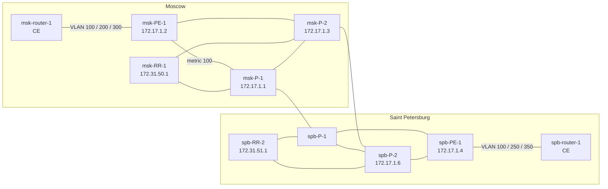
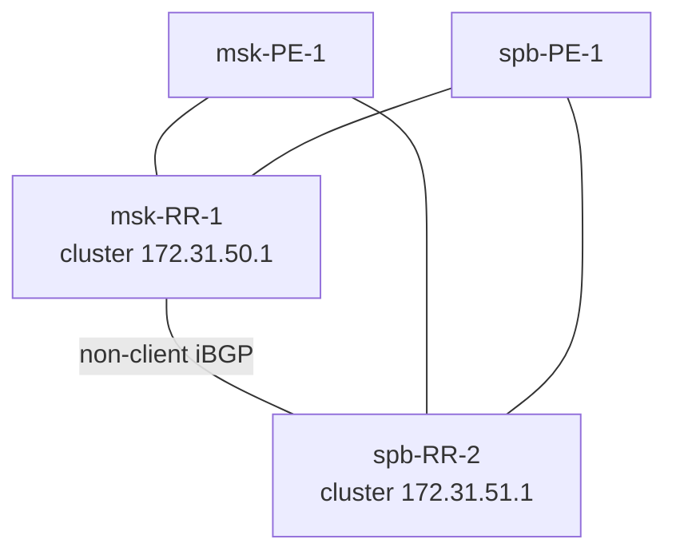

# IP/MPLS Service Provider Lab
 
> **Platform:** EVE-NG | **SP routers:** Juniper vMX, Junos 14.1R1 | **CE:** Cisco IOS, VIOS-ADVENTERPRISEK9-M Version 15.5(3)M | **AS:** 51300  
> **Focus:** BGP-free MPLS core, route reflectors, L3VPN, L2VPN pseudowire, Internet access, Routing Engine protection
 
 
A two-site service provider network (Moscow and Saint Petersburg) built on Juniper vMX in EVE-NG. Over one MPLS core the operator delivers three services to the customer **AstroGlass**: a Layer 3 VPN, a Layer 2 pseudowire and Internet access over eBGP.
 
This README covers the design, the configuration of every layer, how each layer is verified, and the real problems found while building the lab.
 
<!-- TODO: upload sanitized configs to configs/ (show configuration | display set | except encrypted-password) and screenshots to screenshots/, then link them in the sections below -->
 
---
 
## Contents
 
- [Services](#services)
- [What the lab demonstrates](#what-the-lab-demonstrates)
- [Topology](#topology)
- [Addressing](#addressing)
- [Design decisions](#design-decisions)
- [Implementation and verification](#implementation-and-verification)
  - [IGP: OSPF](#igp-ospf)
  - [MPLS: LDP](#mpls-ldp)
  - [BGP: route reflectors](#bgp-route-reflectors)
  - [L3VPN](#l3vpn)
  - [L2VPN: LDP-signalled pseudowire](#l2vpn-ldp-signalled-pseudowire)
  - [Internet access: customer eBGP](#internet-access-customer-ebgp)
  - [Routing Engine protection](#routing-engine-protection)
- [Troubleshooting case studies](#troubleshooting-case-studies)
- [Platform notes: vMX 14.1 on EVE-NG](#platform-notes-vmx-141-on-eve-ng)
- [Roadmap](#roadmap)
- [References](#references)
---
 
## Services
 
| Service | Implementation | Moscow (msk-PE-1) | Saint Petersburg (spb-PE-1) |
|---|---|---|---|
| L3VPN | VRF `AstroGlass`, MP-BGP `inet-vpn` | ge-0/0/1.200, VLAN 200 | ge-0/0/1.250, VLAN 250 |
| L2VPN | `l2circuit`, VC ID 100 | ge-0/0/1.100, VLAN 100 | ge-0/0/1.100, VLAN 100 |
| Internet | eBGP with the customer | ge-0/0/1.300, VLAN 300, AS 4165 | ge-0/0/1.350, VLAN 350, AS 32500 |
 
All three services reach the customer over a single 802.1Q trunk per site, one VLAN per service.
 
---
 
## What the lab demonstrates
 
| Area | Implemented |
|---|---|
| IGP | OSPFv2 area 0, point-to-point core links, IGP metric to select the primary path |
| MPLS | LDP on all core links, targeted LDP for the pseudowire, LSP verification with MPLS OAM |
| BGP | iBGP through two route reflectors with separate cluster IDs, MP-BGP `inet-vpn`, Route Target Constraint, BFD |
| VPN services | L3VPN (VRF, RD/RT, `vrf-table-label`), L2VPN (LDP-signalled pseudowire, Ethernet VLAN mode) |
| Internet | Customer eBGP sessions with inbound prefix filtering |
| Security | Routing Engine protection filter with policers, counters and logging |
| Operations | Layer-by-layer verification, packet-level troubleshooting, isolating a platform limitation |
 
---
 
## Topology
 
<!-- TODO: add the EVE-NG screenshot, e.g.  -->
 
Physical topology: core links and PE–CE trunks.
 

 
BGP control plane. P routers do not run BGP.
 

 
---
 
## Addressing
 
### Loopbacks
 
| Device | Role | lo0 |
|---|---|---|
| msk-RR-1 | Route reflector | 172.31.50.1/32 |
| spb-RR-2 | Route reflector | 172.31.51.1/32 |
| msk-P-1 | P router | 172.17.1.1/32 |
| msk-P-2 | P router | 172.17.1.3/32 |
| spb-P-1 | P router | <!-- TODO: spb-P-1 loopback --> |
| spb-P-2 | P router | 172.17.1.6/32 |
| msk-PE-1 | PE, Moscow | 172.17.1.2/32 |
| spb-PE-1 | PE, Saint Petersburg | 172.17.1.4/32 |
 
### Core links
 
Core links use /30 subnets from 10.10.10.0/24. EVE-NG interfaces `em2`–`em5` correspond to Junos `ge-0/0/0`–`ge-0/0/3`.
 
| Subnet | Side A | Side B |
|---|---|---|
| 10.10.10.0/30 | msk-PE-1 ge-0/0/0 (.2) | msk-P-1 ge-0/0/0 (.1) |
| 10.10.10.4/30 | msk-PE-1 ge-0/0/2 (.5) | msk-P-2 ge-0/0/2 (.6) |
| 10.10.10.16/30 | msk-RR-1 ge-0/0/1 (.17) | msk-P-2 ge-0/0/1 (.18) |
| 10.10.10.20/30 | msk-RR-1 ge-0/0/3 (.21) | msk-P-1 ge-0/0/3 (.22) |
| 10.10.10.40/30 | spb-PE-1 ge-0/0/3 (.42) | spb-P-2 ge-0/0/1 (.41) |
| 10.10.10.44/30 | spb-PE-1 ge-0/0/2 (.45) | spb-P-1 ge-0/0/1 (.46) |
 
<!-- TODO: add the remaining links: msk-P-1–msk-P-2, msk-P-1–spb-P-1, msk-P-2–spb-P-2, spb-P-1–spb-P-2, spb-RR-2–spb-P-1, spb-RR-2–spb-P-2 -->
 
### Service handoff (PE–CE)
 
| Site | Service | PE interface | VLAN | PE address | CE address | Customer AS |
|---|---|---|---|---|---|---|
| Moscow | L2VPN | msk-PE-1 ge-0/0/1.100 | 100 | — | — | — |
| Moscow | L3VPN | msk-PE-1 ge-0/0/1.200 | 200 | 172.18.1.1/30 | 172.18.1.2 | — |
| Moscow | Internet | msk-PE-1 ge-0/0/1.300 | 300 | 72.64.35.121/30 | 72.64.35.122 | 4165 |
| Saint Petersburg | L2VPN | spb-PE-1 ge-0/0/1.100 | 100 | — | — | — |
| Saint Petersburg | L3VPN | spb-PE-1 ge-0/0/1.250 | 250 | 10.170.1.1/30 | 10.170.1.2 | — |
| Saint Petersburg | Internet | spb-PE-1 ge-0/0/1.350 | 350 | 31.120.12.1/30 | 31.120.12.2 | 32500 |
 
---
 
## Design decisions
 
| Decision | Why |
|---|---|
| **BGP-free core** | P routers run only OSPF and LDP. Customer and VPN routes live on PEs and RRs; the core only switches labels and never needs a BGP table. |
| **Out-of-path route reflectors** | RRs are not in the MPLS forwarding path and do not run LDP. Their `inet.3` is empty, so next hops of `bgp.l3vpn.0` and `bgp.rtarget.0` routes are resolved through `inet.0` with `routing-options resolution rib`. |
| **Two RRs, separate clusters** | Each RR uses its own loopback as cluster ID. Every PE peers with both RRs, and the RRs peer with each other as non-clients, so losing one RR does not stop route distribution. |
| **Dual-homed PEs and RRs** | Every PE and RR connects to both P routers of its site, so a single P router or link failure only changes the IGP path. |
| **RD per PE, RT per VPN** | RD = `<PE loopback>:32500`, so routes from different PEs stay distinct on the RRs. A single RT, `target:51300:32500`, defines VPN membership. |
| **Route Target Constraint** | With `family route-target`, PEs signal which RTs they import, and VPN routes are sent only where they are needed. |
| **`vrf-table-label`** | One label per VRF; the egress PE pops it and does an IP lookup in the VRF table. |
| **LDP instead of RSVP-TE** | The lab focuses on service delivery. In production RSVP-TE or Segment Routing would add traffic engineering and fast reroute. |
| **IGP metric for path preference** | `metric 100` on msk-PE-1 towards msk-P-1 makes msk-P-2 the preferred exit from msk-PE-1; the link to msk-P-1 stays as the backup. |
| **BFD on PE–RR sessions** | 300 ms × 3 detects a failure in under a second instead of waiting for the 90-second BGP hold timer. |
| **One trunk, one VLAN per service** | `flexible-ethernet-services` lets one PE–CE port carry a CCC unit (L2VPN) and IP units (L3VPN, Internet) side by side. |
| **Customer link subnets in iBGP** | The PE export policy advertises its customer-facing /30s to the RRs while filtering out core links and loopbacks, so remote PEs can resolve the next hops of customer eBGP routes. |
 
---
 
## Implementation and verification
 
Snippets are taken from msk-PE-1 unless noted otherwise.
 
### IGP: OSPF
 
All SP routers run OSPF area 0. Core links are point-to-point, and loopbacks are advertised so that LDP and BGP can use them. Customer prefixes never enter the IGP.
 
```
set protocols ospf area 0.0.0.0 interface lo0.0
set protocols ospf area 0.0.0.0 interface ge-0/0/0.0 interface-type p2p
set protocols ospf area 0.0.0.0 interface ge-0/0/0.0 metric 100
set protocols ospf area 0.0.0.0 interface ge-0/0/2.0 interface-type p2p
```
 
Verification:
 
```
show ospf neighbor                    # every core neighbor in Full
show ospf route                       # loopbacks of all SP routers
ping 172.17.1.4 source 172.17.1.2     # msk-PE-1 -> spb-PE-1, loopback to loopback
```
 

### MPLS: LDP
 
MPLS and LDP run on every core link. `ldp interface lo0.0` enables targeted LDP between PE loopbacks, which signals the pseudowire.
 
```
set interfaces ge-0/0/2 mtu 2000
set interfaces ge-0/0/2 unit 0 family inet address 10.10.10.5/30
set interfaces ge-0/0/2 unit 0 family mpls
set protocols mpls interface ge-0/0/0.0
set protocols mpls interface ge-0/0/2.0
set protocols ldp interface ge-0/0/0.0
set protocols ldp interface ge-0/0/2.0
set protocols ldp interface lo0.0
```
 
Verification:
 
```
show ldp neighbor
show ldp session
show route table inet.3
ping mpls ldp 172.17.1.4
traceroute mpls ldp 172.17.1.4
```
 
LDP LSPs on msk-PE-1 (`show route table inet.3`):
 
```
172.17.1.3/32      *[LDP/9] 00:32:48, metric 1
                    > to 10.10.10.6 via ge-0/0/2.0
172.17.1.4/32      *[LDP/9] 00:32:48, metric 1
                    > to 10.10.10.6 via ge-0/0/2.0, Push 299792
172.17.1.6/32      *[LDP/9] 00:32:48, metric 1
                    > to 10.10.10.6 via ge-0/0/2.0, Push 299776
```
 
msk-P-2 (172.17.1.3) is the directly connected next hop, so its LSP pushes no label: penultimate hop popping. LSPs towards spb-PE-1 and spb-P-2 push the labels learned from msk-P-2. msk-P-2 is the preferred exit by design: the link to msk-P-1 carries OSPF metric 100.
 
### BGP: route reflectors
 
PE, iBGP to both route reflectors:
 
```
set routing-options autonomous-system 51300
set routing-options resolution rib bgp.rtarget.0 resolution-ribs inet.0
set protocols bgp group BGP-RR type internal
set protocols bgp group BGP-RR local-address 172.17.1.2
set protocols bgp group BGP-RR family inet unicast
set protocols bgp group BGP-RR family inet-vpn unicast
set protocols bgp group BGP-RR family route-target
set protocols bgp group BGP-RR export BGP
set protocols bgp group BGP-RR neighbor 172.31.50.1 bfd-liveness-detection minimum-interval 300
set protocols bgp group BGP-RR neighbor 172.31.50.1 bfd-liveness-detection multiplier 3
set protocols bgp group BGP-RR neighbor 172.31.51.1 bfd-liveness-detection minimum-interval 300
set protocols bgp group BGP-RR neighbor 172.31.51.1 bfd-liveness-detection multiplier 3
```
 
Route reflector msk-RR-1. The `BGP-CLIENTS` group has a cluster ID, so its members are clients; the `BGP-RR` group towards spb-RR-2 has none, so that peering is non-client:
 
```
set routing-options autonomous-system 51300
set routing-options resolution rib bgp.l3vpn.0 resolution-ribs inet.0
set routing-options resolution rib bgp.rtarget.0 resolution-ribs inet.0
set protocols bgp group BGP-CLIENTS type internal
set protocols bgp group BGP-CLIENTS local-address 172.31.50.1
set protocols bgp group BGP-CLIENTS cluster 172.31.50.1
set protocols bgp group BGP-CLIENTS family inet unicast
set protocols bgp group BGP-CLIENTS family inet-vpn unicast
set protocols bgp group BGP-CLIENTS family route-target
set protocols bgp group BGP-CLIENTS neighbor 172.17.1.2 description msk-PE-1
set protocols bgp group BGP-CLIENTS neighbor 172.17.1.4 description spb-PE-1
set protocols bgp group BGP-RR type internal
set protocols bgp group BGP-RR local-address 172.31.50.1
set protocols bgp group BGP-RR family inet unicast
set protocols bgp group BGP-RR family inet-vpn unicast
set protocols bgp group BGP-RR family route-target
set protocols bgp group BGP-RR neighbor 172.31.51.1 description spb-RR-2
```
 
Verification:
 
```
show bgp summary                  # on the RR: both PEs Established
show bfd session                  # on the PEs: sessions to the RRs Up
show route table bgp.rtarget.0    # RT membership from both PEs
show route table bgp.l3vpn.0      # on the RR: VPN routes from both PEs
```
 
<!-- TODO: paste show bgp summary from msk-RR-1 or add a screenshot -->
 
### L3VPN
 
```
set interfaces ge-0/0/1 vlan-tagging
set interfaces ge-0/0/1 encapsulation flexible-ethernet-services
set interfaces ge-0/0/1 unit 200 description L3VPN
set interfaces ge-0/0/1 unit 200 vlan-id 200
set interfaces ge-0/0/1 unit 200 family inet address 172.18.1.1/30
set routing-instances AstroGlass instance-type vrf
set routing-instances AstroGlass interface ge-0/0/1.200
set routing-instances AstroGlass route-distinguisher 172.17.1.2:32500
set routing-instances AstroGlass vrf-target target:51300:32500
set routing-instances AstroGlass vrf-table-label
```
 
`vrf-target` generates the import and export policies: exported routes get the RT attached, and received routes carrying the same RT are imported. On spb-PE-1 the VRF uses ge-0/0/1.250 (10.170.1.1/30) and RD 172.17.1.4:32500.
 
Verification:
 
```
show route table AstroGlass.inet.0
show route advertising-protocol bgp 172.31.50.1 table AstroGlass.inet.0
show route label 16
ping 10.170.1.1 routing-instance AstroGlass source 172.18.1.1
```
 
The remote PE–CE subnet (10.170.1.0/30 on msk-PE-1) appears in `AstroGlass.inet.0` as a BGP route with two labels: the VPN label inside and the LDP transport label on top.
 
With `vrf-table-label` the VRF gets one table label. On msk-PE-1 it is label 16:
 
```
16                 *[VPN/0] 00:33:49
                      to table AstroGlass.inet.0, Pop
```
 
<!-- TODO: paste show route table AstroGlass.inet.0 from msk-PE-1 -->
 
### L2VPN: LDP-signalled pseudowire
 
```
set interfaces ge-0/0/1 unit 100 description L2VPN
set interfaces ge-0/0/1 unit 100 encapsulation vlan-ccc
set interfaces ge-0/0/1 unit 100 vlan-id 100
set interfaces ge-0/0/1 unit 100 family ccc
set protocols l2circuit neighbor 172.17.1.4 interface ge-0/0/1.100 virtual-circuit-id 100
set protocols l2circuit neighbor 172.17.1.4 interface ge-0/0/1.100 mtu 1600
```
 
The pseudowire is signalled over a targeted LDP session between the PE loopbacks (RFC 8077). Both ends must use the same VC ID and MTU, and the core MTU must leave room for the customer frame, the control word and two labels.
 
Verification:
 
```
show l2circuit connections                    # connection Up
show ldp neighbor                             # includes the targeted neighbor 172.17.1.4 via lo0.0
ping mpls l2circuit interface ge-0/0/1.100
```
 
Pseudowire state on msk-PE-1:
 
```
l2circuit.0
172.17.1.4:CtrlWord:4:100:Local/96
                   *[L2CKT/7] 00:33:05, metric2 1
                    > to 10.10.10.6 via ge-0/0/2.0, Push 299792
 
mpls.0
299776             *[L2CKT/7] 00:32:43
                    > via ge-0/0/1.100, Pop       Offset: 4
ge-0/0/1.100       *[L2CKT/7] 00:32:43, metric2 1
                    > to 10.10.10.6 via ge-0/0/2.0, Push 299776, Push 299792(top) Offset: 252
```
 
- `CtrlWord:4:100`: the control word is used, encapsulation type 4 is Ethernet VLAN mode, VC ID 100.
- Frames received on ge-0/0/1.100 get two labels: the pseudowire label 299776 advertised by spb-PE-1, and the LDP label 299792 towards spb-PE-1 on top.
- Pseudowire label 299776 arriving from the core is popped and the frame leaves via ge-0/0/1.100. Both PEs happened to allocate the same value, 299776, for their side of the pseudowire.
### Internet access: customer eBGP
 
msk-PE-1:
 
```
set interfaces ge-0/0/1 unit 300 description Internet
set interfaces ge-0/0/1 unit 300 vlan-id 300
set interfaces ge-0/0/1 unit 300 family inet address 72.64.35.121/30
set protocols bgp group CLIENTS type external
set protocols bgp group CLIENTS neighbor 72.64.35.122 peer-as 4165
```
 
spb-PE-1 accepts only the prefix assigned to the customer:
 
```
set policy-options prefix-list AstroGlass-Internet 95.235.16.0/24
set policy-options policy-statement IMPORT-ASTOGLASS-INTERNET term 1 from prefix-list AstroGlass-Internet
set policy-options policy-statement IMPORT-ASTOGLASS-INTERNET term 1 then accept
set policy-options policy-statement IMPORT-ASTOGLASS-INTERNET then reject
set protocols bgp group CLIENTS neighbor 31.120.12.2 passive
set protocols bgp group CLIENTS neighbor 31.120.12.2 import IMPORT-ASTOGLASS-INTERNET
set protocols bgp group CLIENTS neighbor 31.120.12.2 peer-as 32500
```
 
The export policy on the `BGP-RR` group advertises the customer-facing /30s to the RRs and keeps core links and loopbacks out of BGP:
 
```
set policy-options prefix-list DENY 10.10.10.0/24
set policy-options prefix-list DENY 172.17.1.0/24
set policy-options policy-statement BGP term DENY from protocol direct
set policy-options policy-statement BGP term DENY from prefix-list-filter DENY orlonger
set policy-options policy-statement BGP term DENY then reject
set policy-options policy-statement BGP term BGP from protocol direct
set policy-options policy-statement BGP term BGP then accept
```
 
As a result, remote PEs resolve the next hops of customer eBGP routes through an LSP. On msk-PE-1 the spb-PE-1 customer link is a BGP route:
 
```
31.120.12.0/30     *[BGP/170] 00:04:01, localpref 100, from 172.31.50.1
                      AS path: I, validation-state: unverified
                    > to 10.10.10.6 via ge-0/0/2.0, Push 299792
```
 
Verification:
 
```
show bgp summary
show route receive-protocol bgp 31.120.12.2       # what the customer announces
show route advertising-protocol bgp 31.120.12.2   # what the customer receives
```
 
<!-- TODO: add a "Customer sites" section from the CE configs (VLANs, router-on-a-stick, VPCs) -->
 
### Routing Engine protection
 
The `PROTECT-RE` filter on lo0.0 admits only the control and management traffic the router needs and discards everything else.
 
| Term | Match | Action |
|---|---|---|
| BGP | TCP 179 | accept |
| OSPF | protocol OSPF | accept |
| LDP | TCP and UDP 646 | accept |
| BFD | UDP 3784, 4784 | accept |
| MPLS-OAM | UDP 3503 | accept |
| ICMP | echo request/reply, unreachable, time exceeded | policer 1 Mbit/s, accept |
| TRACEROUTE | UDP 33434–33534 | policer 1 Mbit/s, accept |
| REMOTE-ACCESS | TCP 22, 23 | accept |
| DENY-ALL | everything else | count, log, discard |
 
On the route reflectors the LDP and MPLS-OAM terms are omitted.
 
The original design restricted every term by source address. On this vMX build source matching does not work for OSPF hellos, so the OSPF and LDP terms match on protocol and port only; source restriction still works for unicast terms such as BGP. See [case study 3](#3-all-protocols-down-after-hardening-the-lo0-filter).
 
Verification:
 
```
show firewall filter PROTECT-RE   # DENY-ALL counter and policer drops
show firewall log                 # what is being discarded right now
```
 
---
 
## Troubleshooting case studies
 
### 1. L3VPN: remote PE–CE subnets missing from the VRF
 
**Symptom.** `AstroGlass.inet.0` on each PE contained only its own Direct and Local routes.
 
**Diagnosis.** Neither the PEs nor the RR had a `bgp.l3vpn.0` table: no VPN routes existed anywhere in the network. The VRF used explicit `vrf-import` and `vrf-export` with the same policy:
 
```
set policy-options policy-statement EXPORT-VRF term RT from community ASTROGLASS-RT
set policy-options policy-statement EXPORT-VRF term RT then accept
```
 
**Root cause.** `from community` is a valid import condition but a wrong export one. Locally originated VRF routes carry no communities, so the term never matched and nothing was exported. The RT was also inconsistent between the PEs, which went unnoticed because explicit policies override `vrf-target`.
 
**Fix.** Remove the explicit policies and use one RT on both PEs:
 
```
delete routing-instances AstroGlass vrf-import
delete routing-instances AstroGlass vrf-export
set routing-instances AstroGlass vrf-target target:51300:32500
```
 
**Lesson.** An export policy must add the RT (`then community add`); an import policy matches it.
 
### 2. VPN routes not sent to the RR (Route Target Constraint)
 
**Symptom.** After the first fix the VPN routes existed on the PEs, but the RR still received none. On msk-RR-1:
 
```
Peer                     AS      InPkt     OutPkt    OutQ   Flaps Last Up/Dwn State|#Active/Received/Accepted/Damped...
172.17.1.2            51300          9          5       0       2          33 Establ
  inet.0: 1/1/1/0
  bgp.l3vpn.0: 0/0/0/0
  bgp.rtarget.0: 1/1/1/0
172.17.1.4            51300          9          6       0       2          33 Establ
  inet.0: 1/1/1/0
  bgp.l3vpn.0: 0/0/0/0
  bgp.rtarget.0: 0/1/1/0
```
 
**Diagnosis.** With `family route-target`, a PE sends VPN routes to a peer only if that peer has advertised interest in the RT. On the PEs the RT membership route received from the RR was hidden:
 
```
show route table bgp.rtarget.0 hidden extensive
 
51300:51300:32500/96 (2 entries, 1 announced)
         BGP    Preference: 170/-101
                Next hop type: Unusable
                State: <Hidden Int Ext>
                Inactive reason: Unusable path
                Task: BGP_51300.172.31.50.1+179
```
 
**Root cause.** The next hop of the membership route could not be resolved in `inet.3`: the RR is outside the MPLS domain and has no LSP towards it. The route became unusable, and the PE concluded that the RR had no interest in the VPN.
 
**Fix.** Resolve `bgp.rtarget.0` next hops through `inet.0` on the PEs, as the RR already did:
 
```
set routing-options resolution rib bgp.rtarget.0 resolution-ribs inet.0
```
 
After the change the RR received VPN routes from both PEs, and the remote PE–CE subnets appeared in both VRFs.
 
### 3. All protocols down after hardening the lo0 filter
 
**Symptom.** After committing a new `PROTECT-RE` with source-restricted terms, OSPF, LDP, BGP and BFD went down on every router where the filter was applied.
 
**Diagnosis.** `show firewall log` on spb-PE-1 showed OSPF hellos from the neighbor being discarded, and the DENY-ALL counter grew by one packet per hello interval:
 
```
Time      Filter    Action Interface     Protocol        Src Addr                         Dest Addr
13:02:19  pfe       D      ge-0/0/3.0    OSPF            10.10.10.41                      224.0.0.5
13:02:09  pfe       D      ge-0/0/3.0    OSPF            10.10.10.41                      224.0.0.5
13:01:59  pfe       D      ge-0/0/3.0    OSPF            10.10.10.41                      224.0.0.5
```
 
The OSPF term accepted OSPF from 10.10.10.0/24, so 10.10.10.41 should have matched.
 
**Isolation.**
 
| Test | Result |
|---|---|
| OSPF term with `source-prefix-list` | hellos dropped |
| OSPF term with `source-address 10.10.10.0/24` | hellos dropped |
| OSPF term without a source condition | adjacency Full |
| BGP term with `source-address` (unicast) | sessions stay Established |
 
**Root cause.** On vMX 14.1R1 with its software PFE, source matching in the lo0 filter did not work for OSPF hellos, which are multicast to 224.0.0.5, while it worked for BGP, which is unicast. The previous filter never exposed this because its working terms matched only protocol and port.
 
**Fix.** The OSPF and LDP terms match on protocol and port only; LDP discovery hellos are multicast too, so LDP is treated the same way as OSPF. Unicast terms can still be restricted by source.
 
**Lessons.**
 
- Apply Routing Engine filters with `commit confirmed`, one router at a time.
- Keep `count` and `log` in the final term: they turn "everything is down" into one line of evidence.
- Paste long configurations with `load set terminal`.
---
 
## Platform notes: vMX 14.1 on EVE-NG
 
- **Slow data plane start.** The Routing Engine boots first; FPC 0 and PIC 0 need several more minutes. Until PIC 0 is online, `ge-` interfaces do not exist. Check with `show chassis fpc pic-status`.
- **FPC watchdog panics.** Repeated `fpc0 PANIC ... Watchdog fired` messages mean the VM lacks CPU, RAM or KVM acceleration. Give the node more resources, and if EVE-NG itself runs in a VM, enable nested virtualization.
- **lo0 filter limitation.** Source matching fails for OSPF hellos; see [case study 3](#3-all-protocols-down-after-hardening-the-lo0-filter).
- **Pasting configuration.** Long `set` blocks pasted into the EVE-NG console can silently lose lines. Use `load set terminal`, finish with Ctrl+D, and check `show | compare` before committing.
---
 
## Roadmap
 
- [ ] Bring spb-RR-2 back into service and test RR failover.
- [ ] Customer edge hardening: inbound prefix filter on msk-PE-1, explicit export policy towards customers, prefix limits, uRPF and an infrastructure ACL.
- [ ] PE–CE routing inside the VRF (static or eBGP) to carry the customer LANs.
- [ ] Move to vJunos-router or a newer vMX and restore source-restricted OSPF and LDP terms.
- [ ] RSVP-TE with fast reroute as an alternative transport.
---
 
## References
 
- [RFC 2328 — OSPF Version 2](https://www.rfc-editor.org/rfc/rfc2328)
- [RFC 3031 — Multiprotocol Label Switching Architecture](https://www.rfc-editor.org/rfc/rfc3031)
- [RFC 5036 — LDP Specification](https://www.rfc-editor.org/rfc/rfc5036)
- [RFC 4456 — BGP Route Reflection](https://www.rfc-editor.org/rfc/rfc4456)
- [RFC 4364 — BGP/MPLS IP Virtual Private Networks](https://www.rfc-editor.org/rfc/rfc4364)
- [RFC 4684 — Constrained Route Distribution for BGP/MPLS IP VPNs](https://www.rfc-editor.org/rfc/rfc4684)
- [RFC 8077 — Pseudowire Setup and Maintenance Using LDP](https://www.rfc-editor.org/rfc/rfc8077)
- [RFC 4448 — Encapsulation Methods for Transport of Ethernet over MPLS Networks](https://www.rfc-editor.org/rfc/rfc4448)
- [RFC 5880 — Bidirectional Forwarding Detection](https://www.rfc-editor.org/rfc/rfc5880)
- [RFC 5883 — BFD for Multihop Paths](https://www.rfc-editor.org/rfc/rfc5883)
- Ivan Pepelnjak, Jim Guichard — *MPLS and VPN Architectures* (Cisco Press)
- [EVE-NG documentation](https://www.eve-ng.net/index.php/documentation/)
---
 
## Author
 
**Aleksandr Gerasimov** — Network Engineer  
[LinkedIn](https://linkedin.com/in/a1exger)
 
---
 
*Lab environment built for education and portfolio purposes. Core addressing uses RFC 1918 space; customer-facing "public" prefixes are arbitrary values used only inside the lab.*
